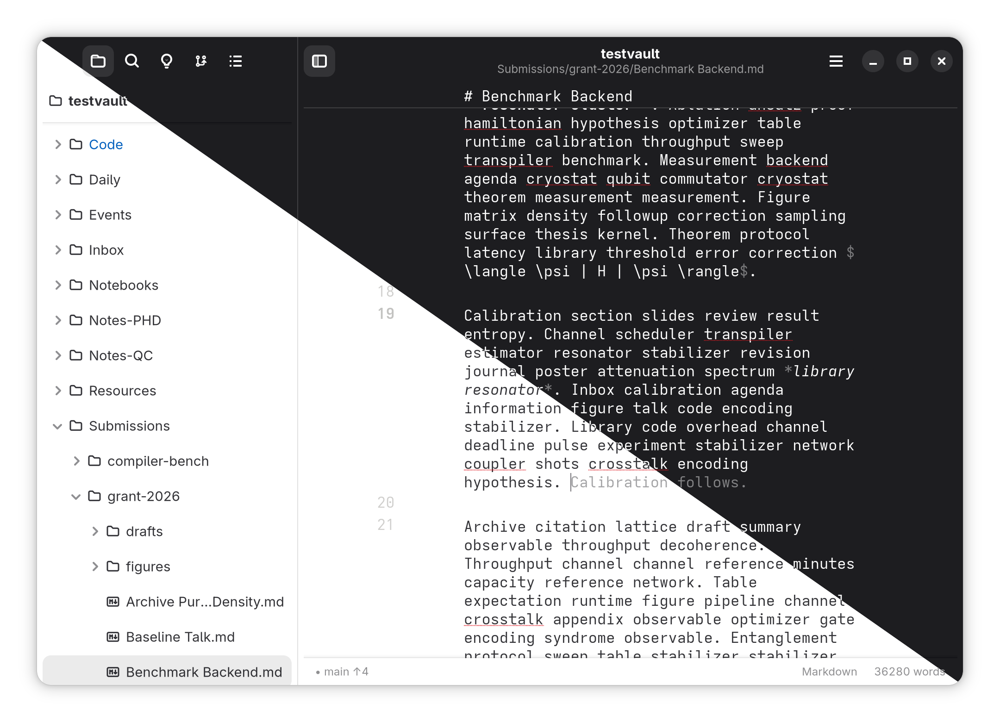
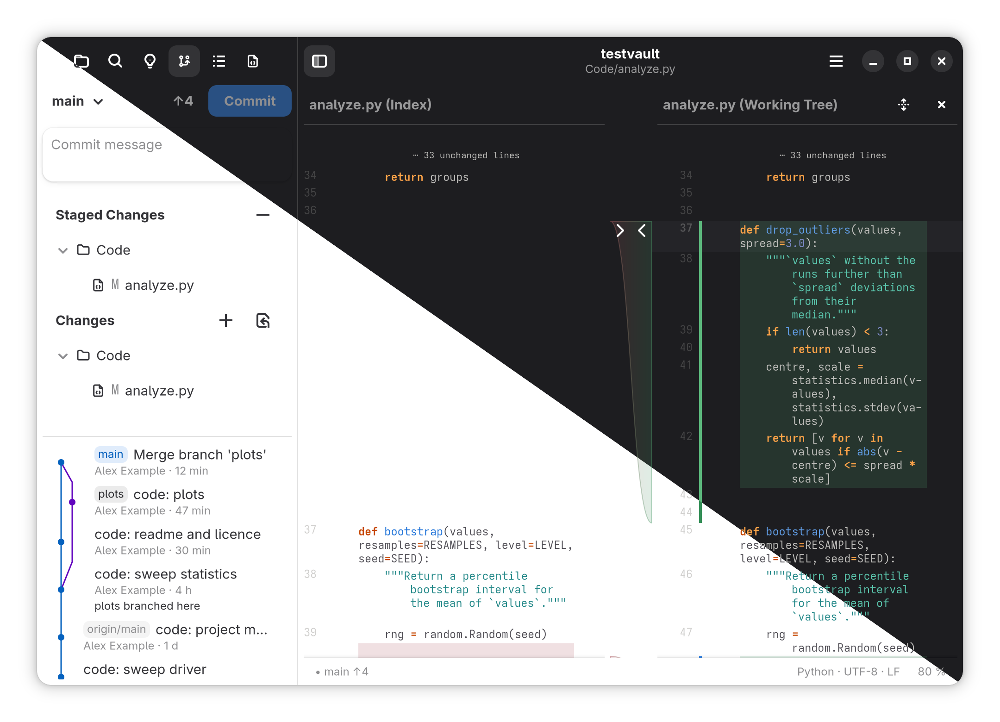
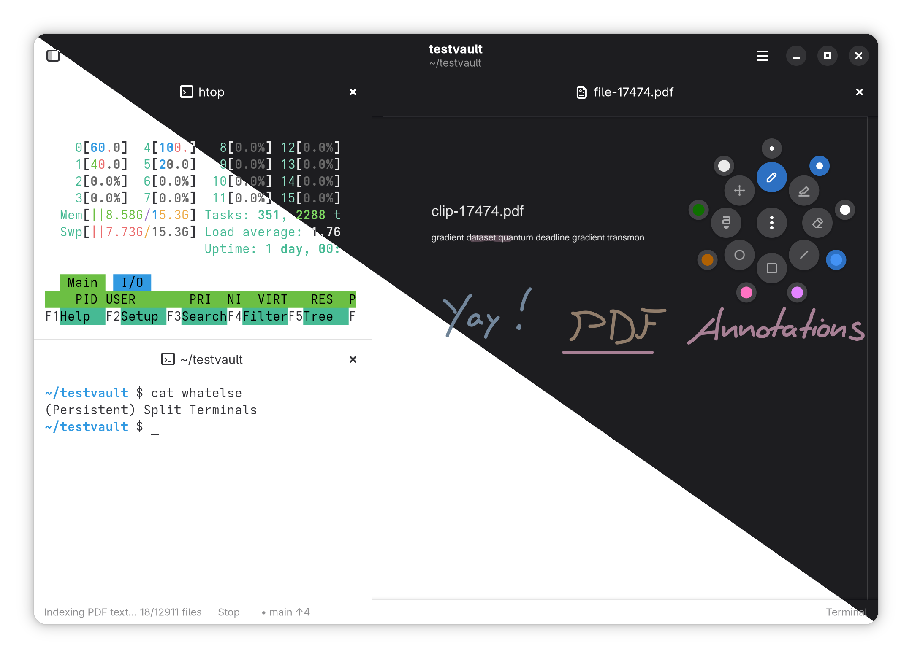
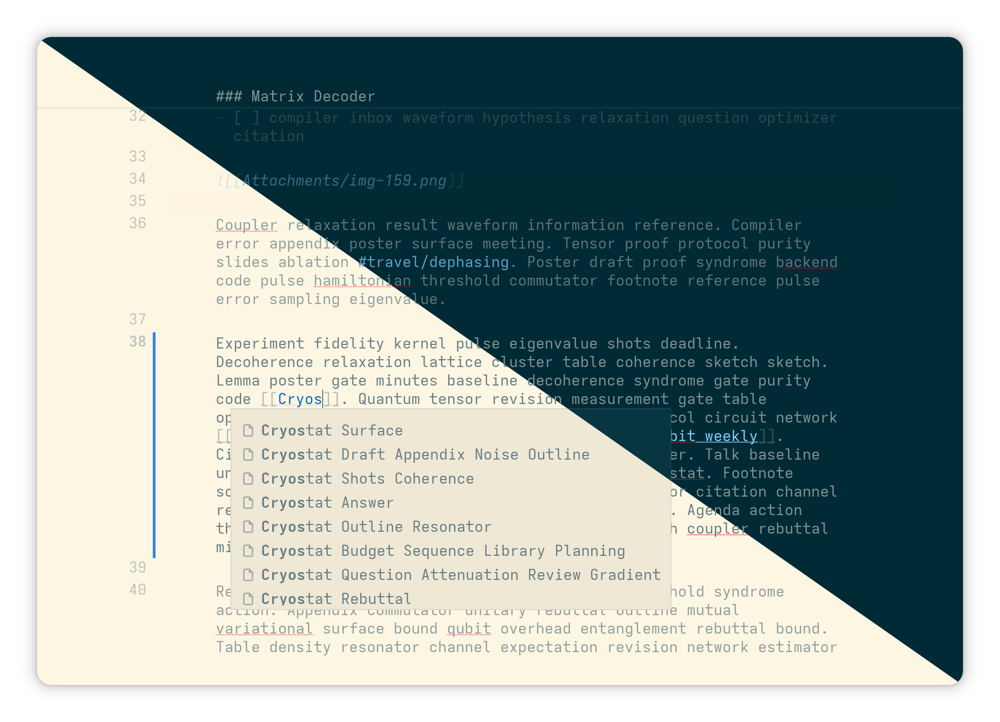
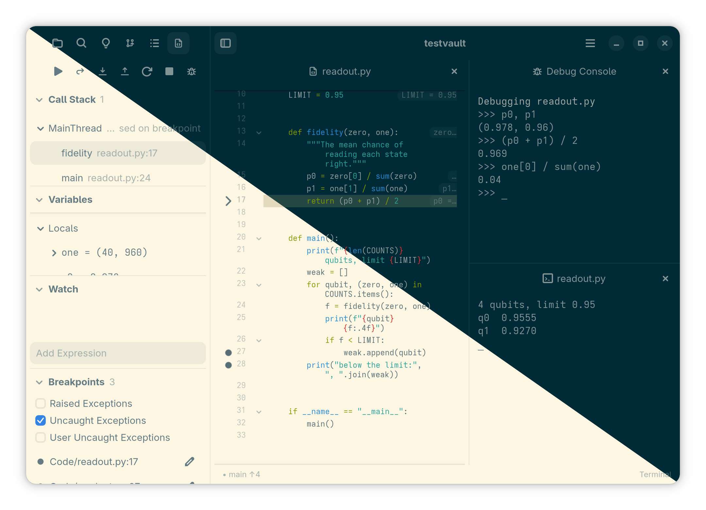
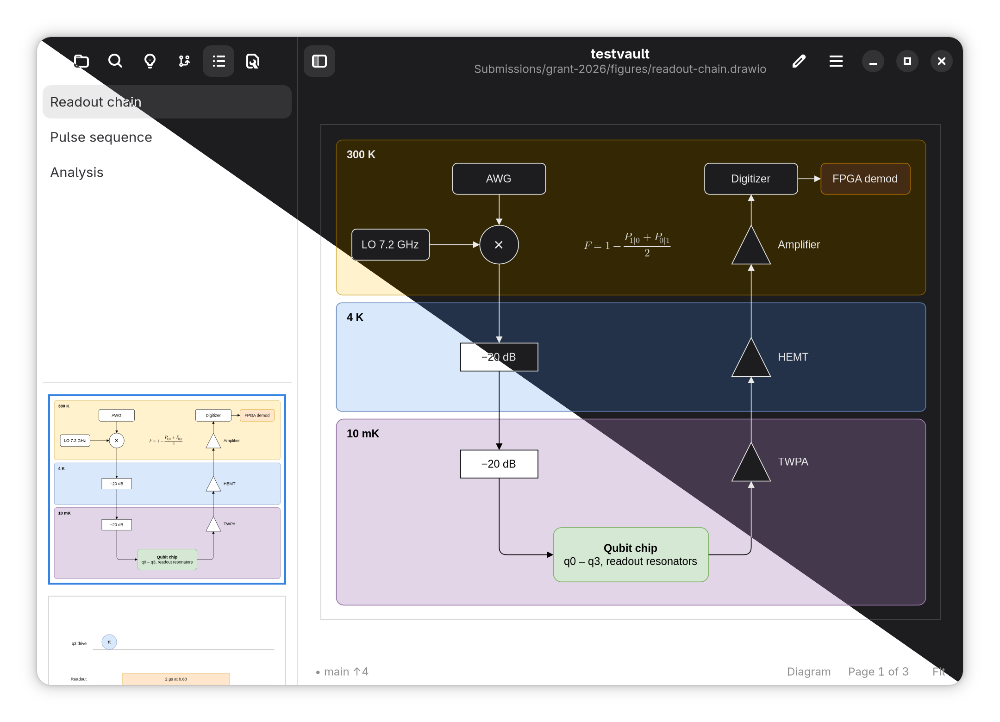
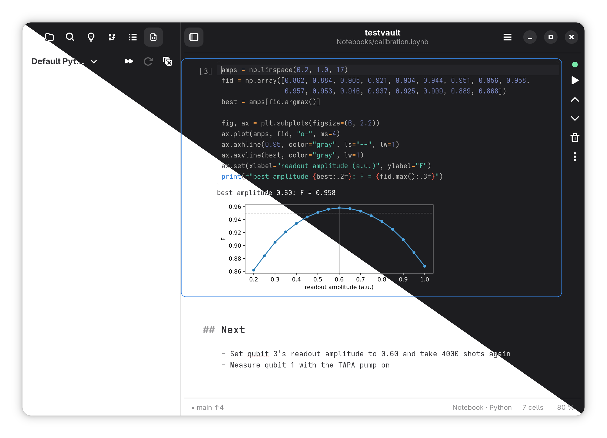

# Accent

<p align="center">
  
</p>

<p align="center">
  <a href="https://github.com/stroblme/accent/actions/workflows/tests.yml?query=branch%3Amain"></a>
  <a href="LICENSE"></a>
  <a href="https://github.com/stroblme/accent/releases/latest"></a>
</p>

Accent is an opinionated editor for code, markdown/org notes, and PDFs.
It features an integrated terminal (emulator) and is AI ready without being bloated.
I use it as my daily driver to replace VSCode, Obsidian, Xournal++, draw.io, a PDF reader and terminal emulators.
Enjoy...

- working in vaults (workspaces) which can be any combinations of folders, files, terminals etc.. 
- editing code with multi-line carets, inline suggestions and syntax highlighting.
- writing notes, use templates, and browse links and tags, just like you know from [Obsidian](https://obsidian.md/).
- reading and annotating PDFs (handwriting support) with back-links (highlights) to your notes.
- using split panes, shortcuts, and a command palette to work productively.
- working with Git history, diff-views, terminal sessions, and on remote hosts over SSH.

Some other cool features involve (but are not limited to):
- Vault-less support; you can use Accent **just** as a PDF reader, **just** as a terminal, etc..
- Prefer modal editors? You can use [vim](https://www.vim.org/), [helix](https://helix-editor.com/) etc. seamlessly instead of the built-in editor.
- Focus mode, which fades out everything that is not around the caret.
- Persistent terminal sessions a la `tmux`; don't panic when closing a window with a job running.
- Automatic light and dark theme with a solarized option for both.
- Presentation mode to show off whatever you're working on.
- Early version of a native rust-based draw.io editor.
- MCP server and [Codegraph](https://github.com/colbymchenry/codegraph)-like `explore` command to make agents more efficient.
- LaTeX (SyncTeX) PDF <-> Code sync: navigate from text to pdf and vice-versa.

... and many more.
I'm constantly adding new features and fixing bugs; let me know if you find some or got new ideas.

Accent is open source under GPL-3.0-or-later.
See the [device support](#device-support) for compatibility.

## Screenshots















## Get started

Curious? Just try it out!
Follow the steps below and head over to the [user guide](https://stroblme.github.io/accent/) for an initial setup.

### Desktop

A Flatpak bundle for `x86_64` and `aarch64` is shipped with each [release](https://github.com/stroblme/accent/releases):

```sh
flatpak install --user accent-<version>-<arch>.flatpak
```

Additionally, each release also carries native packages for Ubuntu 26.04 or newer, Debian testing, Fedora 44 or newer and openSUSE Tumbleweed.
Older releases of these distributions lack the GNOME 49 libraries accent links against, so the Flatpak is the way to go there.

```sh
sudo apt install ./accent-<version>-<distro>-<arch>.deb	# Ubuntu, Debian
sudo dnf install ./accent-<version>-fedora-44-<arch>.rpm	# Fedora
sudo zypper install --allow-unsigned-rpm ./accent-<version>-opensuse-tumbleweed-<arch>.rpm
```

On NixOS, `nix run github:stroblme/accent` builds and starts it from the flake in this repository.

If you rather like to build Accent yourself, go for the following one-liner:

```sh
curl -fsSL https://raw.githubusercontent.com/stroblme/accent/main/install.sh | bash
```

To remove it again, add `-s -- --uninstall` after `bash`.

To build from source by hand, run:

```sh
make install-requirements	# install the build requirements (openSUSE, Fedora, Debian, Ubuntu, Arch)
make requirements	# check local dependencies
make pdfium     	    # optional, for PDFs
make all        	    # build the GTK app and accent-cli
make install			# install the app user-wide
```

Note that support for macOS is in a very early stage.

`accent-cli mcp` serves a vault to an AI agent over the Model Context Protocol.
It shares the app's index, works with the window closed, and offers search, code exploration, backlinks, tags, links and PDF highlights. 
Writing tools ensure version-match to what the agent reads.
E.g. for Claude Code:

```sh
claude mcp add accent -- /path/to/accent-cli mcp --vault /path/to/notes
```

See [Command line and MCP](https://stroblme.github.io/accent/cli.html) for the other commands and remote vaults.

### Android

For Android, you can use [Obtainium](https://obtainium.imranr.dev/) to retrieve the `.apk` from the releases.

To build it from source, install a JDK, the Android SDK and NDK, then build a debug APK:

```sh
make android-tools
make apk
```

Note that the Android companion app is still in a very early version; please be gentle.

## Device support

Some general notes on the support and availability on different platforms:

| Feature                        | Linux (native)   | Linux (Flatpak)        | macOS 15+ | Android 12+ |
| ------------------------------ | ---------------- | ---------------------- | --------- | ----------- |
| Notes, search, tags, backlinks | Yes              | Yes                    | Yes       | Yes         |
| PDF reading & highlights       | Yes              | Yes                    | Yes       | Yes         |
| PDF drawing & page editing     | Yes              | Yes                    | Yes       | No          |
| draw.io diagrams               | Yes              | Yes                    | Yes       | No          |
| Git                            | Yes              | Yes                    | Yes       | No          |
| Persistent terminals           | Yes              | Yes, with host shells  | Yes       | No          |
| Python debugging               | Yes              | Remote vaults only     | ?         | No          |
| Notebooks                      | Yes              | Yes, with host kernels | ?         | No          |
| Spell checking                 | Yes              | Yes                    | No        | No          |
| Remote vaults                  | x86-64 & AArch64 | Same architecture      | Yes       | No          |
| MCP server                     | Yes              | Yes                    | Yes       | No          |

Accent has very few resource requirements for the remote deamon, allowing you to remote develop on small devices like the Raspberry Pi Zero 2 W (512 MB).

## Credits

Accent is inspired by awesome software projects like [Apostrophe](https://github.com/ApostropheEditor/Apostrophe), [Obsidian](https://obsidian.md/), and [VSCodium](https://vscodium.com/). 
Icons come from [Tabler](https://github.com/tabler/tabler-icons).
