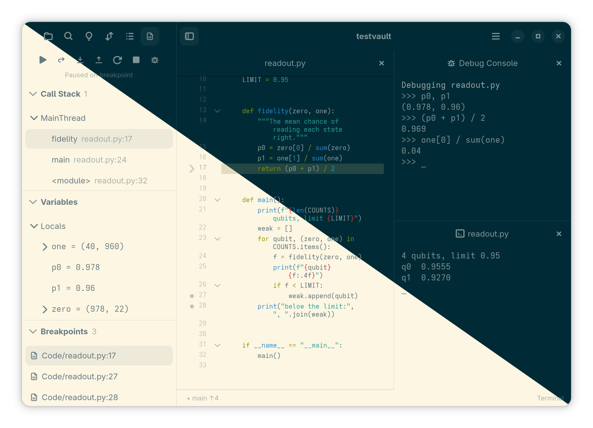

# Accent

<p align="center">
  
</p>

<p align="center">
  <a href="https://github.com/stroblme/accent/actions/workflows/tests.yml?query=branch%3Amain"></a>
  <a href="LICENSE"></a>
  <a href="https://github.com/stroblme/accent/releases/latest"></a>
</p>

Accent is a Linux workspace for Markdown notes, code, PDFs and draw.io diagrams. A vault is an ordinary folder of files that remains usable in other apps.

- **Connect notes to their sources:** wikilinks, tags and backlinks sit beside PDF passage links that take you from a note to the exact selection and back.
- **Edit the documents, not just view them:** annotate and rearrange PDFs, edit draw.io diagrams on a native canvas, and jump between LaTeX source and its PDF with SyncTeX.
- **Keep your tools together:** split panes, multi-caret code editing, language servers, Jupyter cells, Git diffs and merge resolution, and terminal sessions that survive closing the window.
- **Work on another machine:** open a vault over SSH while search, Git and development tools run on the host. `accent-cli` also exposes vault search, links and code exploration to agents over MCP.
- **Choose how to focus:** a command palette and keyboard shortcuts sit alongside focus and presentation modes, system light and dark themes, and Solarized. An Android companion edits notes and reads PDFs.

Accent is open source under GPL-3.0-or-later and still evolving.
Read the [user guide](https://stroblme.github.io/accent/) for setup, feature details and current platform limits.

## Screenshots




## Get started

### Desktop

A Flatpak bundle is shipped with each [release](https://github.com/stroblme/accent/releases):

```sh
flatpak install --user accent-<version>-x86_64.flatpak
```

For a native install into `~/.local` (GNOME 49 or newer: Fedora 43+, openSUSE Tumbleweed, Debian testing, Ubuntu 26.04+, Arch), go for the following:

```sh
curl -fsSL https://raw.githubusercontent.com/stroblme/accent/main/install.sh | bash
```

To remove it again, add `-s -- --uninstall` after `bash`.

To build from source by hand, run:

```sh
make install-requirements	# install the build requirements (openSUSE, Fedora, Debian, Ubuntu, Arch)
make requirements	# check local dependencies
make pdfium     	    # optional, for PDFs
make all        	    # build the GTK app and accent-cli
make install			# install the app user-wide
```

If you run `accent` from a terminal, you can also provide a path to a file or folder to open it directly.

`accent-cli mcp` serves a vault to an AI agent over the Model Context Protocol. It shares the app's index, works with the window closed, and offers search, code exploration, backlinks, tags, links and PDF highlights. Writing tools check the version the agent read; `--read-only` leaves them out. For Claude Code:

```sh
claude mcp add accent -- /path/to/accent-cli mcp --vault /path/to/notes
```

See [Command line and MCP](https://stroblme.github.io/accent/cli.html) for the other commands and remote vaults.

### Android

For Android, you can use [Obtainium](https://obtainium.imranr.dev/) to retrieve the `.apk` from the releases.

To build it from source, install a JDK, the Android SDK and NDK, then build a debug APK:

```sh
make android-tools
make apk
```

Note that the Android companion app is still in a very early version; please be gentle.

## Credits

Accent is inspired by awesome software projects like [Apostrophe](https://github.com/ApostropheEditor/Apostrophe), [Obsidian](https://obsidian.md/), and [VSCodium](https://vscodium.com/). 
Icons come from [Tabler](https://github.com/tabler/tabler-icons).
