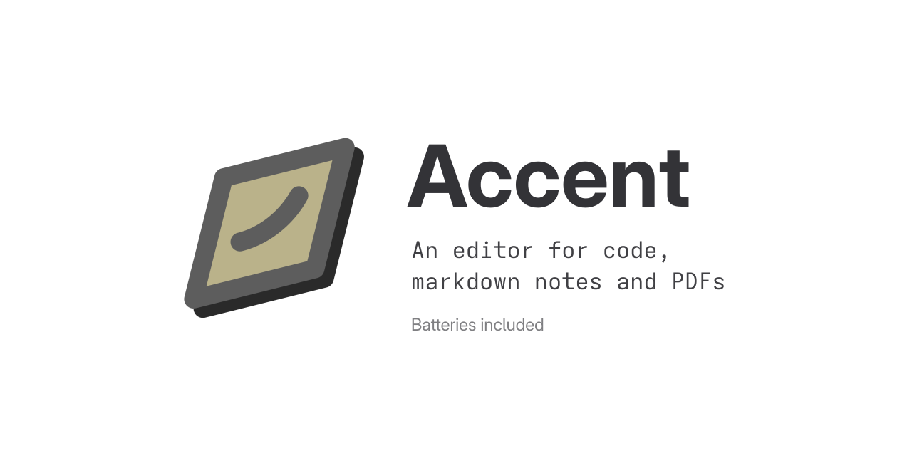

# Welcome to Accent



Accent brings notes, code, PDFs and drawings into one workspace. A **vault** is an ordinary folder of files: your files stay yours, and other apps can edit them too.
The desktop app runs on Linux, with an [Android companion](android.md) for editing notes and reading PDFs.

## What you can do

- **Connect notes and sources.** Follow [wikilinks, tags and backlinks](notes.md), embed drawings, and [link a selected PDF passage to a note](pdf.md#link-a-passage-to-a-note). The link takes you back to the passage.
- **Work directly on documents.** [Annotate and rearrange PDF pages](pdf.md), edit [draw.io diagrams](diagrams.md) on a native canvas, and move between LaTeX source and its PDF with [SyncTeX](code.md#latex-and-synctex).
- **Keep development in the same window.** Edit [code](code.md), run [Jupyter cells](notebooks.md), review and resolve [Git changes](git.md), and return to [terminal sessions](terminals.md) after closing the window.
- **Work where the files live.** Open a vault over [SSH](remote.md) with search, Git and tools running on its host, or let an agent use the vault through the [command line and MCP server](cli.md).

## Install and open a vault

Download the Flatpak bundle from the [latest release](https://github.com/stroblme/accent/releases/latest), then install it with:

```sh
flatpak install --user accent-<version>-x86_64.flatpak
```

For a native install on a recent GNOME Linux system, use the [installer](https://github.com/stroblme/accent/blob/main/install.sh):

```sh
curl -fsSL https://raw.githubusercontent.com/stroblme/accent/main/install.sh | bash
```

Open Accent and choose **Open Local…** to use a folder you already have, or make a new one in the folder chooser.
Accent will show its files in the sidebar and start indexing them for [search](search.md) and links.
The files remain ordinary files in that folder.

You can also open a folder from a terminal with `accent ~/Notes`.
See [The workspace](vaults.md) for the window, tabs and file tree, or start with [your first note](notes.md).
For a folder on another machine, see [Remote hosts](remote.md).
