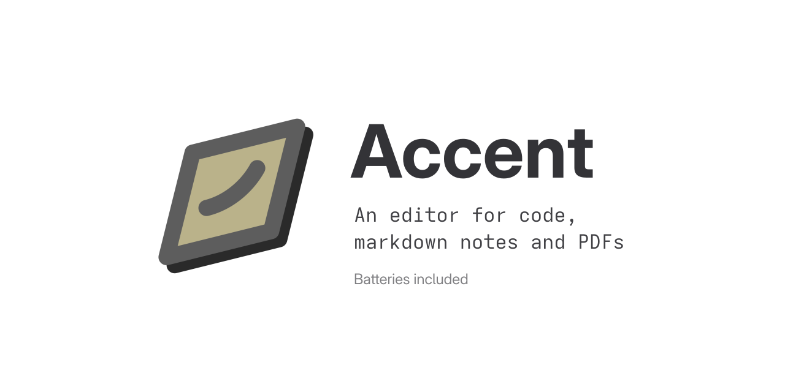

# Welcome to Accent



Accent allows you to work with code, PDFs and drawings in a single workspace, which we call a **vault**.
Its files remain ordinary files, alongside any terminal sessions you open in Accent.

In such a vault, you can use Accent to

- **Connect notes and sources.** Follow [wikilinks, tags and backlinks](notes.md), embed drawings, and [link a selected PDF passage to a note](pdf.md#link-a-passage-to-a-note). The link takes you back to the passage.
- **Work directly on documents.** [Annotate and rearrange PDF pages](pdf.md), edit [draw.io diagrams](diagrams.md) on a native canvas, and move between LaTeX source and its PDF with [SyncTeX](code.md#latex-and-synctex).
- **Keep development in the same window.** Edit [code](code.md), run [Jupyter cells](notebooks.md), review and resolve [Git changes](git.md), and return to [terminal sessions](terminals.md) after closing the window.
- **Manage references.** Edit [BibTeX bibliographies](bibliography.md), import references by DOI and attach their PDFs.
- **Work where the files live.** Open a vault over [SSH](remote.md) with search, Git and tools running on its host, or let an agent use the vault through the [command line and MCP server](cli.md).


## Install and open a vault

Accent supports Linux through native and Flatpak installations, macOS, and an Android companion app.

Download the Flatpak bundle for your machine (`x86_64` or `aarch64`) from the [latest release](https://github.com/stroblme/accent/releases/latest), then install it with:

```sh
flatpak install --user accent-<version>-<arch>.flatpak
```

The same release carries native packages for Ubuntu 26.04 or newer, Debian testing, Fedora 44 or newer and openSUSE Tumbleweed, which install with `sudo apt install ./<file>.deb`, `sudo dnf install ./<file>.rpm` or `sudo zypper install --allow-unsigned-rpm ./<file>.rpm`.
On NixOS, `nix run github:stroblme/accent` builds and starts it.

For a native install on any other recent GNOME Linux system, use the [installer](https://github.com/stroblme/accent/blob/main/install.sh):

```sh
curl -fsSL https://raw.githubusercontent.com/stroblme/accent/main/install.sh | bash
```

For macOS 15 or later, download the disk image for Apple Silicon or Intel from the same release and copy Accent.app into Applications.
The app is signed ad hoc, so macOS may require you to allow its first launch in Privacy & Security.
For Android installation and its available features, see [Android app](android.md).

Open Accent and choose **Open Local…** to use a folder you already have, or make a new one in the folder chooser.
Accent will show its files in the sidebar and start indexing them for [search](search.md) and links.
The files remain ordinary files in that folder.

You can also open a folder from a terminal with `accent ~/Notes`.
See [The workspace](vaults.md) for the window, tabs and file tree, or start with [your first note](notes.md).
For a folder on another machine, see [Remote hosts](remote.md).
